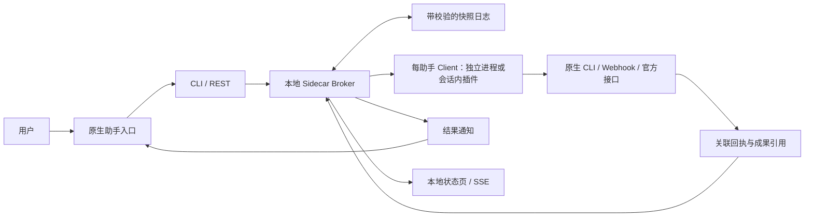

# AGI Hub

从你选定的 AI 助手出发，用一个入口协调其他已接入助手：提出目标、交接工作、查看进度，最终在原入口获得成果。

**Use your preferred AI assistant as one entry point to coordinate your other assistants.**

管理对象是具体助手的工作会话、宿主应用和执行环境。你决定接入哪些助手、谁作为逻辑 leader，以及每个助手负责什么。第一版先围绕个人日常任务做最小闭环，分工偏好可以调整。

项目面向 Codex、WorkBuddy、Claude、Grok Bot 等原生 AI 助手。当前入口可以通过设置 leader 切换，接入由用户控制；每个助手的实际支持范围见适配器说明。程序采用本地边车部署方式。

> 当前是本地开发版。2026-10-15，macOS 已通过两轮独立 WorkBuddy/CodeBuddy CLI 会话的完整 MQ 忙时返回。用户重新授权后，原 WorkBuddy 会话也完成一次真实单联系人查询：首轮未接手，由入口核对并显式续接一次，随后原生主动回报，Core 核验成果，再由独立 Node Client 经官方 Desktop MCP 自动返回忙碌的 Codex 原聊天。联系人候选与成果字段一致；这不代表全通讯录唯一匹配、全部企微业务或全部桌面工具已通过。同一 Desktop MCP 的单次空闲原聊天启动另已实测，Codex 原入口空闲时的完整 MQ 回路及其他平台仍未验收。[完整记录](docs/NATIVE-VALIDATION.md)

> 2026-10-16，Claude-3p Desktop 本地 Code 原会话（2.1.299）已完成单次空闲唤醒，以及 Codex → Hub → Claude 原生工具执行 → 成果核验 → 自动返回忙碌 Codex 原聊天。N3 首轮遇到回报工具输出格式错误；Client 0.1.3 修复后只显式续接一次回报，没有重派任务或重写成果。未重复进行修复后全新任务的无人值守验收，也未验证 Claude 忙时排队与其他平台。[Claude 验收记录](docs/NATIVE-VALIDATION.md#2026-10-16claude-3p-原-code-会话)

## 首页导览

- [功能与范围](#功能与范围)
- [架构与技术](#架构与技术)
- [快速开始](#快速开始)
- [数据与个人配置](#数据与个人配置)
- [适配器与支持边界](docs/ADAPTERS.md)
- [交给 AI 助手的安装指南](docs/INSTALL-FOR-ASSISTANT.md)
- [消息协议与回执](docs/PROTOCOL.md)
- [独立 Client 与版本维护](docs/CLIENTS.md)
- [自动安装会话技能](docs/SKILLS.md)
- [本机原生验证记录](docs/NATIVE-VALIDATION.md)

## 功能与范围

| 已实现 | 行为 |
| --- | --- |
| 少量会话绑定 | 每个 endpoint 绑定一台设备上的一个原生会话，用户选择是否启用 |
| 可切换 leader | 作为新任务的默认入口；历史任务保留自己的入口与协调记录 |
| 任务与成果交接 | 完整 JSON 信封、必要摘要、带设备和工作区信息的文件引用 |
| 独立状态 | 区分投递、接手、执行中、需要用户、成功、失败和中断 |
| 去重与恢复 | 稳定任务 ID、回执事件 ID、校验日志；投递不确定时保留记录 |
| 协调并发 | 对边车管理的运行按会话排队，支持声明共享工作区或桌面资源 |
| 本地状态页 | 查看当前处理者、结果位置和需要介入的情况，使用 SSE 更新 |

第一版每个用户任务只交接一次，终态只生成一次结果通知，`max_handoffs` 固定为 `1`。暂不做自动规划、递归互答、智能能力排名、账号体系或插件市场。

## 架构与技术



| 项目 | 选择 |
| --- | --- |
| 协调内核 | Go 标准库，单个可执行文件，零外部 Go 依赖 |
| 助手 Client | 独立进程或原生会话内插件；Python Client 使用 Python 3.11+ 标准库，Codex Desktop MCP 使用 Node 22+ 标准库，Claude Code 插件使用宿主 mods API，均无第三方包依赖 |
| 消息与状态 | 本地 broker、每 endpoint 的持久化收件箱、统一 JSON 协议 |
| 持久化 | 追加写入完整状态快照，SHA-256 校验，写入后同步 |
| 控制接口 | 带授权的 HTTP loopback REST、SSE 与最长 25 秒的事件长轮询 |
| 界面 | 内置简单状态页，由本机浏览器打开 |
| 系统目标 | Windows、macOS、Linux；原生适配能力分别验证 |

Hub 本身不需要 Redis、RabbitMQ、SQLite、Docker、Python 或 Node.js。构建内核需要 Go 1.22+，运行已构建的 Hub 不需要 Go。Python Client 需要 Python 3.11+；WorkBuddy CLI 还需官方 CLI 安装，JavaScript 入口需要 Node.js。Codex Desktop MCP 的本机验证使用官方 Node runtime 与自然宿主环境，其运行链须单独核实。Claude Code Client 直接运行在已打开的 Code 会话内，不需要另装 Node.js 或 Python；当前以宿主 2.1.299 开发与校验。Client 可以用不同语言实现。

先使用单仓库，每个助手一个目录，分别声明 Client 版本、协议版本、原生会话类型和支持模式。Hub 与 Client 分别更新；兼容协议内替换一个 Client 不需要重新编译 Hub。未来独立维护或发布时可以拆仓库，共享 runtime 固定版本后随 Client 分发。独立进程支持启停与替换；Claude Code 通过原生插件重载更新，并以 Hub 原子租约避免重复消费。自动托管和无损热更新尚未实现。[维护与更新](docs/CLIENTS.md#单独更新和拔插)

“边车”沿用软件架构中的 Sidecar 含义：在已有应用旁边补充配套能力。这里将协调逻辑与原生助手执行分开。[微软 Sidecar 模式](https://learn.microsoft.com/zh-cn/azure/architecture/patterns/sidecar)

详细设计见 [ARCHITECTURE.md](docs/ARCHITECTURE.md)。

## 构建与打包

```sh
go test -race ./...
go vet ./...
go run ./tools/package
python3 -m unittest discover -s clients/tests
python3 tools/smoke_client.py --hub dist/darwin-arm64/agi-hub
```

最后一条需换成当前系统对应的已构建程序。它运行真实 Hub 与 Python 协议，使用临时目录和模拟 Adapter 核对一次交接、成果校验、结果返回及不重复消费，不向真实助手发消息。

打包命令生成 Windows、macOS、Linux 的 amd64/arm64 Hub 程序、便携 ZIP 和 `SHA256SUMS`，输出到 `dist/`。包内含 Client 源码、Claude Code 插件、运行说明和空凭据配置示例；插件只包含明确列出的 JavaScript 与三类插件 JSON，不打包私有配置或持久记录。每种原生助手的唤醒、原生工具和发送模式仍需在目标系统实测。

当前验证：本机测试与并发检查通过；六个目标平台构建通过；macOS arm64 便携程序的初始化、默认禁用配置启动、鉴权状态查询和正常关闭通过。此前两轮独立 CLI 的完整 MQ 忙时返回已有原生回报、文件校验和资源释放证据。用户重新授权后，原 WorkBuddy 会话的一次单联系人查询也已通过，原始工具结果返回候选，成果字段与返回一致，并自动回传忙碌原入口；该次首轮未接手，需要由入口核对后显式续接一次。同一 Desktop MCP 的空闲原聊天启动已单独实测；Codex 原入口空闲时的完整 MQ 回路、App Server proxy 的空闲启动与其他平台原生运行仍未验收。

## 快速开始

在源码根目录构建并创建私有配置：

```sh
git clone https://github.com/OdysseusC/AGI-hub.git
cd AGI-hub
go build -o agi-hub ./cmd/agi-hub
./agi-hub init
./agi-hub doctor
./agi-hub serve --open
```

Windows PowerShell 使用 `go build -o agi-hub.exe ./cmd/agi-hub`，后续命令将 `./agi-hub` 换为 `.\agi-hub.exe`。

`init` 打印配置路径，创建 Codex、WorkBuddy、Grok、Claude 四个禁用绑定，没有会话 ID、空闲唤醒验证或默认 leader。`doctor` 只检查 Hub 配置，不向助手发送消息。实际投递需要先完成 [会话绑定、技能安装和 Client 配置](docs/INSTALL-FOR-ASSISTANT.md)。

完成绑定并在原生应用中确认指定会话空闲后，在另一终端声明状态、选择入口、提交任务。以下使用配置中的 `codex` 和 `grok` endpoint，必须先验证两端的接收与回报路径：

```sh
./agi-hub session --endpoint codex --state idle
./agi-hub session --endpoint grok --state idle
./agi-hub leader --endpoint codex
./agi-hub submit --to grok --goal "整理已指定资料，返回可核对的摘要" --context "只使用本次明确提供的资料"
./agi-hub status
```

每次重启后，原生会话状态都恢复为 `unknown`。重新核对状态后再继续；不能为了让任务投递而把正在工作或尚未确认的会话标成 `idle`。

| 命令 | 用途 |
| --- | --- |
| `init` / `doctor` | 创建私有配置；进行不发送消息的检查 |
| `serve --open` / `dashboard` | 运行边车并打开状态页；打开已运行的状态页 |
| `status` / `session` | 查看记录；声明核对过的原生会话状态 |
| `leader` / `submit` | 切换默认入口；提交任务或受支持的控制请求 |
| `report` | 从任务接收端回报完整 Report JSON |
| `install-skill` | 自动安装会话接手与回报技能；拒绝覆盖用户改动 |
| `client-config` | 将 endpoint 专用凭据写入仓库外的新私有文件，不打印 token |
| `inbox` / `delivery` | 领取指定 endpoint 的消息；记录或核对投递结果 |

每个命令可以使用 `--help`，也可以通过 `--data` 指定本机私有数据目录。带文件引用的任务与回报示例见 [安装指南](docs/INSTALL-FOR-ASSISTANT.md)。

## 数据与个人配置

默认目录为 `os.UserConfigDir()/agi-hub`：

| 系统 | 通常位置 |
| --- | --- |
| macOS | `~/Library/Application Support/agi-hub` |
| Windows | `%AppData%\agi-hub` |
| Linux | `$XDG_CONFIG_HOME/agi-hub`，未设置时通常为 `~/.config/agi-hub` |

目录保存私有 `config.json`、各 Client 的 `client.json` 和状态日志 `state.jsonl`。`init` 与 `client-config` 拒绝覆盖已有文件。代码仓库与个人配置分开；不要提交令牌、真实聊天、私密上下文或成果文件。

文件只支持同机 allowlist 工作区中的相对路径，并校验存在性与 SHA-256。输入传递的是引用，文件不会自动复制或冻结；跨设备文件传输尚未实现。

## 当前边界

- 内核理解 `queue / steer / interrupt`；当前 Codex、WorkBuddy、Grok Routine、Claude Code Client 只实现 `queue`。Claude Code 的会话内 mod 已在 macOS Claude-3p 2.1.299 原会话验证空闲唤醒，完整回路经一次修复后回报续接完成；Claude 忙时排队、其他平台仍待验收，普通 Chat、Cowork、WSL 会话不支持。[Claude Code 配置](clients/claude-code/README.md)
- WorkBuddy Client `0.2.1` 显式选择官方 CLI 会话恢复或本地助理 OpenAPI。独立 CLI 的 MQ 执行和成果校验已通过；用户重新授权后，原 WorkBuddy 会话经入口核对并显式续接一次，已完成单联系人新查询、原生回报和自动忙时回传。此前远端授权过期保留为历史，不再作为当前阻点；这项验收不覆盖全部企微业务或完整桌面工具注入。OpenAPI 需要第三方正式 OAuth，不能由 CLI 登录推导授权。[配置与范围](clients/workbuddy/README.md)
- Codex Desktop MCP 与 App Server proxy 是不同通道。官方 Desktop MCP 已在独立 Node 启动链验证忙时即时引导；本机 Python 父链曾遇签名校验失败，App Server proxy 则缺少控制 socket。后两项不能推导 Desktop MCP 不可用。本机已有两轮完整 MQ 忙时返回和一次同通道空闲启动诊断的分别证据。空闲诊断确认旧轮次 completed、原聊天 idle 后只发送一次，原聊天已进入不同的新轮次且官方桌面 read_thread 工具仍可用；它不构成 idle 下完整 MQ 回路。
- 原生接收工具返回成功只代表投递，任务完成须核对回报和要求的成果文件。`uncertain` 不自动重发。
- 会话排队与资源互斥只覆盖边车管理的运行；人工在原生会话或同一桌面并发操作仍需协调。初期建议使用专属会话。
- 授权范围作为任务元数据传递，不能提供原生权限沙盒。助手消息不能批准用户的权限提示。
- 截止时间只约束未投递任务，不能强制终止已经运行的原生任务；暂无原生 token 消耗计量。
- 单条日志记录最多 4 MiB、日志最多 128 MiB，达到上限停止写入并保留历史。日志压缩与长期压力验证尚未完成。

## 常用文档与目录

- [架构、协议与恢复](docs/ARCHITECTURE.md)
- [适配器、官方依据与待验证条件](docs/ADAPTERS.md)
- [安装、配置、提交与回报](docs/INSTALL-FOR-ASSISTANT.md)
- [完整消息协议](docs/PROTOCOL.md)

```text
cmd/agi-hub/         命令入口
internal/manager/    协议、队列、资源协调、校验日志
internal/app/        Hub 配置、REST/SSE、状态页
internal/install/    嵌入式接手技能与安全安装
clients/codex/       Codex 独立 Client、manifest 与配置示例
clients/workbuddy/   WorkBuddy 独立 Client、manifest 与配置示例
clients/grok-routine/ Grok Routine 独立 Client、manifest 与配置示例
clients/claude-code/ Claude Code 会话内插件、marketplace 与配置示例
clients/shared/      固定版本的协议与传输 runtime
docs/                架构与接入说明
tools/package/       标准库便携打包工具
tools/smoke_client.py Hub 与 Python Client 的模拟闭环检查
```

验收围绕一个真实任务：是否减少切换入口、复制粘贴、传文件和追问进度，同时保持成果质量。文档组织参考 [Codex-Manager](https://github.com/qxcnm/Codex-Manager/tree/main) 的分层方式。

## 开源许可

采用 [MIT License](LICENSE)。源码、公共示例和说明可以进入仓库；个人配置、实际任务日志与成果文件保存在私有目录。
