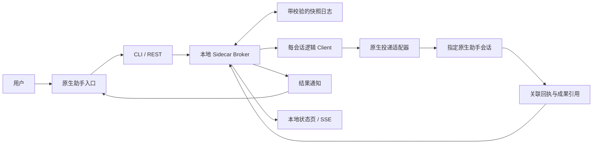

# AGI Hub

从你选定的 AI 助手出发，用一个入口协调其他已接入助手：提出目标、交接工作、查看进度，最终在原入口获得成果。

**Use your preferred AI assistant as one entry point to coordinate your other assistants.**

管理对象是具体助手的工作会话、宿主应用和执行环境。你决定接入哪些助手、谁作为逻辑 leader，以及每个助手负责什么。第一版先围绕个人日常任务做最小闭环，分工偏好可以调整。

项目面向 Codex、WorkBuddy、Claude、Grok Bot 等原生 AI 助手。当前入口可以通过设置 leader 切换，接入由用户控制；每个助手的实际支持范围见适配器说明。程序采用本地边车部署方式。

> 当前是本地开发版：协议、投递驱动和状态界面已有实现，原生目标会话的真实闭环仍未验收。当前开发验证环境为 macOS arm64；跨平台构建不能证明各平台的原生助手已经可用。

## 首页导览

- [功能与范围](#功能与范围)
- [架构与技术](#架构与技术)
- [快速开始](#快速开始)
- [数据与个人配置](#数据与个人配置)
- [适配器与支持边界](docs/ADAPTERS.md)
- [交给 AI 助手的安装指南](docs/INSTALL-FOR-ASSISTANT.md)
- [消息协议与回执](docs/PROTOCOL.md)

## 功能与范围

| 已实现 | 行为 |
| --- | --- |
| 少量会话绑定 | 每个 endpoint 绑定一台设备上的一个原生会话，用户选择是否启用 |
| 可切换 leader | 作为新任务的默认入口；历史任务保留自己的入口与协调记录 |
| 任务与成果交接 | 完整 JSON 信封、必要摘要、带设备和工作区信息的文件引用 |
| 独立状态 | 区分投递、接手、执行中、需要用户、成功、失败和中断 |
| 去重与恢复 | 稳定任务 ID、回执事件 ID、校验日志；投递不确定时保留记录 |
| 协调并发 | 对边车管理的运行按会话排队，支持声明共享工作区或桌面资源 |
| 本地状态页 | 查看当前处理者、结果位置和需要介入的情况，使用 SSE 更新 |

第一版每个用户任务只交接一次，终态只生成一次结果通知，`max_handoffs` 固定为 `1`。暂不做自动规划、递归互答、智能能力排名、账号体系或插件市场。

## 架构与技术



| 项目 | 选择 |
| --- | --- |
| 语言与运行 | Go 标准库，单个可执行文件，零外部 Go 依赖 |
| 消息与状态 | 本地 broker、每 endpoint 的逻辑 client、统一 JSON 协议 |
| 持久化 | 追加写入完整状态快照，SHA-256 校验，写入后同步 |
| 控制接口 | 带授权的 HTTP loopback REST 与 SSE |
| 界面 | 内置简单状态页，由本机浏览器打开 |
| 系统目标 | Windows、macOS、Linux；原生适配能力分别验证 |

不需要 Redis、RabbitMQ、SQLite、Docker、Node.js 或 Python。构建源码需要 Go 1.22 或更高版本；运行已构建的程序不需要 Go。

“边车”沿用软件架构中的 Sidecar 含义：在已有应用旁边补充配套能力。这里将协调逻辑与原生助手执行分开。[微软 Sidecar 模式](https://learn.microsoft.com/zh-cn/azure/architecture/patterns/sidecar)

详细设计见 [ARCHITECTURE.md](docs/ARCHITECTURE.md)。

## 构建与打包

```sh
go test -race ./...
go vet ./...
go run ./tools/package
```

打包命令使用 Go 工具链生成 Windows、macOS、Linux 的 amd64/arm64 单文件程序、便携 ZIP 和 `SHA256SUMS`，输出到 `dist/`。包内含运行说明和空凭据配置示例。每种原生助手的唤醒、原生工具和发送模式仍需在目标系统实测。

当前验证：本机测试与并发检查通过；六个目标平台构建通过；macOS arm64 便携程序的初始化、默认禁用配置启动、鉴权状态查询和正常关闭通过。Windows、Linux 和 macOS amd64 的实际运行，以及原生助手闭环，尚待验收。

## 快速开始

在源码根目录构建并创建私有配置：

```sh
git clone https://github.com/OdysseusC/AGI-hub.git
cd AGI-hub
go build -o agi-hub ./cmd/agi-hub
./agi-hub init
./agi-hub doctor
./agi-hub serve --open
```

Windows PowerShell 使用 `go build -o agi-hub.exe ./cmd/agi-hub`，后续命令将 `./agi-hub` 换为 `.\agi-hub.exe`。

`init` 打印配置路径，创建的绑定默认禁用、没有会话 ID、没有空闲唤醒验证，也没有默认 leader。`doctor` 只检查配置和可执行文件，不向助手发送消息。此时可以查看界面，实际投递需要先完成 [安装与会话绑定](docs/INSTALL-FOR-ASSISTANT.md)。

完成绑定并在原生应用中确认指定会话空闲后，在另一终端声明状态、选择入口、提交任务。以下使用配置中的 `codex` 和 `grok` endpoint，必须先验证两端的接收与回报路径：

```sh
./agi-hub session --endpoint codex --state idle
./agi-hub session --endpoint grok --state idle
./agi-hub leader --endpoint codex
./agi-hub submit --to grok --goal "整理已指定资料，返回可核对的摘要" --context "只使用本次明确提供的资料"
./agi-hub status
```

每次重启后，原生会话状态都恢复为 `unknown`。重新核对状态后再继续；不能为了让任务投递而把正在工作或尚未确认的会话标成 `idle`。

| 命令 | 用途 |
| --- | --- |
| `init` / `doctor` | 创建私有配置；进行不发送消息的检查 |
| `serve --open` / `dashboard` | 运行边车并打开状态页；打开已运行的状态页 |
| `status` / `session` | 查看记录；声明核对过的原生会话状态 |
| `leader` / `submit` | 切换默认入口；提交任务或受支持的控制请求 |
| `report` | 从任务接收端回报完整 Report JSON |

每个命令可以使用 `--help`，也可以通过 `--data` 指定本机私有数据目录。带文件引用的任务与回报示例见 [安装指南](docs/INSTALL-FOR-ASSISTANT.md)。

## 数据与个人配置

默认目录为 `os.UserConfigDir()/agi-hub`：

| 系统 | 通常位置 |
| --- | --- |
| macOS | `~/Library/Application Support/agi-hub` |
| Windows | `%AppData%\agi-hub` |
| Linux | `$XDG_CONFIG_HOME/agi-hub`，未设置时通常为 `~/.config/agi-hub` |

目录保存私有 `config.json` 和状态日志 `state.jsonl`。`init` 拒绝覆盖已有配置。代码仓库与个人配置分开；不要提交令牌、真实聊天、私密上下文或成果文件。

文件只支持同机 allowlist 工作区中的相对路径，并校验存在性与 SHA-256。输入传递的是引用，文件不会自动复制或冻结；跨设备文件传输尚未实现。

## 当前边界

- 内核理解 `queue / steer / interrupt`；现有 `codex-queue` 与 `webhook` 投递驱动只支持 `queue`。`command` 仅承载用户预先验证的原生接口能力。
- 原生接收工具返回成功只代表投递，任务完成须核对回报和要求的成果文件。`uncertain` 不自动重发。
- 会话排队与资源互斥只覆盖边车管理的运行；人工在原生会话或同一桌面并发操作仍需协调。初期建议使用专属会话。
- 授权范围作为任务元数据传递，不能提供原生权限沙盒。助手消息不能批准用户的权限提示。
- 截止时间只约束未投递任务，不能强制终止已经运行的原生任务；暂无原生 token 消耗计量。
- 单条日志记录最多 4 MiB、日志最多 128 MiB，达到上限停止写入并保留历史。日志压缩与长期压力验证尚未完成。

## 常用文档与目录

- [架构、协议与恢复](docs/ARCHITECTURE.md)
- [适配器、官方依据与待验证条件](docs/ADAPTERS.md)
- [安装、配置、提交与回报](docs/INSTALL-FOR-ASSISTANT.md)
- [完整消息协议](docs/PROTOCOL.md)

```text
cmd/agi-hub/         命令入口
internal/manager/    协议、队列、资源协调、校验日志
internal/driver/     原生投递驱动
internal/app/        配置、逻辑 client、REST/SSE、状态页
docs/                架构与接入说明
tools/package/       标准库便携打包工具
```

验收围绕一个真实任务：是否减少切换入口、复制粘贴、传文件和追问进度，同时保持成果质量。文档组织参考 [Codex-Manager](https://github.com/qxcnm/Codex-Manager/tree/main) 的分层方式。

## 开源许可

采用 [MIT License](LICENSE)。源码、公共示例和说明可以进入仓库；个人配置、实际任务日志与成果文件保存在私有目录。
