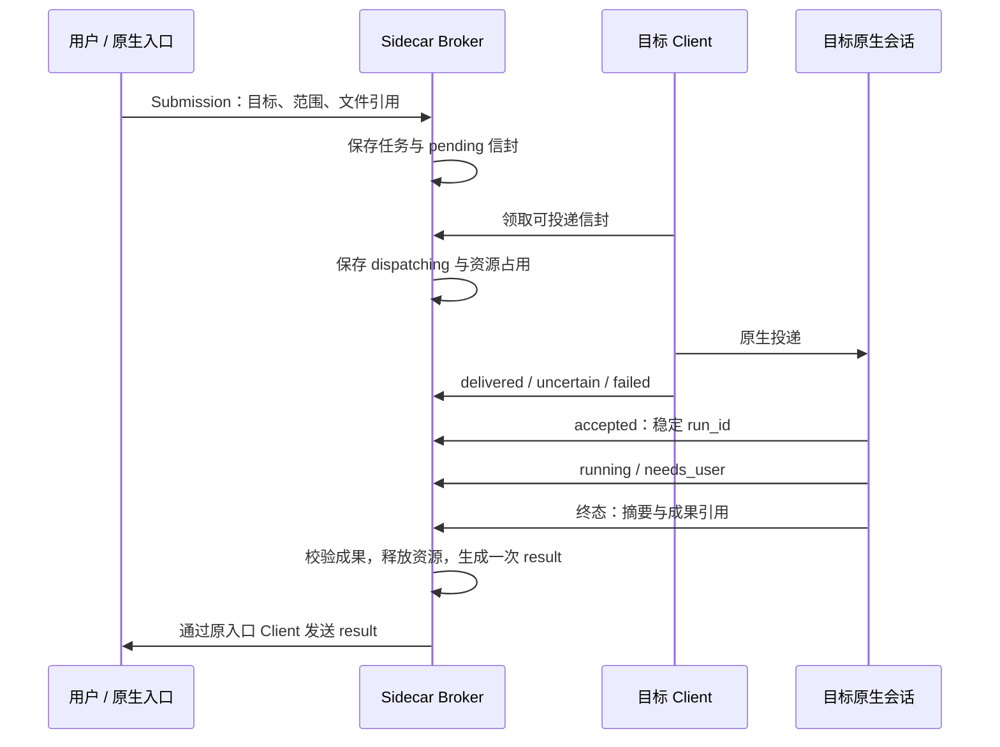

# 架构与协议

AGI Hub 的第一版是单设备本地协调器。用户继续在原生助手中工作，边车记录任务、交接与回执，适配器只调用明确配置且已验证的接入机制。

## 对象与职责

| 对象 | 职责 |
| --- | --- |
| Endpoint | 一个具体助手会话的绑定：设备、原生会话 ID、驱动、已验证模式与启用状态 |
| Leader | 新任务的默认入口；用户可以切换，系统不推定助手能力排名 |
| Broker | 保存状态、领取消息、去重、检查运行目标、协调声明的资源 |
| Client | 每 endpoint 独立的逻辑投递者；当前在同一个边车进程中运行 |
| Driver | 通过官方或用户已验证的原生接口投递，返回传输状态 |
| Report | 接收端带关联 ID 的执行回执和成果引用 |

同一设备上的同一原生会话不能以多个 endpoint 重复注册。仍有未完成任务或未解决消息的 endpoint 不能随意重新绑定。

切换 leader 影响之后提交任务的默认 `origin` 和协调纪元。已有任务保留 `origin`、`coordinator`、`leader_epoch`，结果回到原入口；不会迁移聊天上下文或改写历史任务。

## 一个任务的生命周期

所有变更先持久化，再通知订阅者。结果通知是信息交付，不会再次执行原任务，也不要求对原任务再发送接手回执。当前没有自动递归任务创建。

## 两层状态

| 投递 `delivery` | 含义 |
| --- | --- |
| `pending` | 尚未领取，等待会话、资源与期限条件 |
| `dispatching` | 已持久化领取，正在尝试原生投递 |
| `delivered` | 传输已确认；或原生执行回执确认接手 |
| `uncertain` | 已尝试，但无法确定对方是否收到；等待核对 |
| `failed` | 已明确失败，例如配置错误或启动前失败 |

执行 `execution` 另外使用 `waiting / accepted / running / needs_user / succeeded / failed / interrupted`。`delivered`、工具返回、原生会话闲置都不能代替 `succeeded`。

`accepted / running / needs_user` 必须有执行 `run_id`，后续回执沿用它；控制请求必须引用目标运行。成功回执必须有摘要，要求成果的任务还必须提供至少一个可验证文件。

## 控制、并发与授权

| 模式 | 内核语义 | 当前投递边界 |
| --- | --- | --- |
| `queue` | 作为后续工作排队；会话已核对为 idle，且没有边车管理的未完成运行 | 三种驱动均可承载，仍需原生验证 |
| `steer` | 对匹配的活跃管理运行提供引导；必须带 `target_run_id` | 仅预先验证的自定义原生 driver |
| `interrupt` | 请求中断匹配的活跃管理运行；完成须有实际 `interrupted` 回执 | 仅预先验证的自定义原生 driver |

三个模式都需要 endpoint 声明支持。内置 Codex 队列与 Webhook 只投递 `queue`；另外两种模式需要预先验证的自定义原生 driver，不能降级成普通消息后假称已控制运行。

`resources` 是用户声明的互斥资源 ID，例如 `workspace:daily-work` 或 `desktop:this-device`。边车在领取任务时占用资源，在终态释放。未声明的原生人工操作不受此机制管理，因此初期应使用专属会话并主动协调桌面操作。

`authorized_actions` 传递本任务已有的授权范围，是元数据约定。它不会改变原生权限，也不会形成操作系统沙盒。接手助手不能代表用户批准工具审批、提升权限或扩大任务范围。

当前每个用户任务 `max_handoffs=1`，只生成一个 task/control 和一个 result，不自动规划下一轮。`deadline` 只在投递前判断是否过期，不能终止原生已运行的任务。

## 文件与成果

输入 `inputs` 与结果 `artifacts` 使用同一种 Artifact：`device_id / workspace_id / path / sha256`。工作区由私有配置映射到现有的本机绝对目录，信封只携带引用。

输入在提交前校验，成功成果在回报时校验：设备必须匹配，工作区必须在 allowlist 内，路径必须是可移植相对路径，文件必须存在且为普通文件。拒绝绝对路径、越界路径和逃逸工作区的符号链接；提供 SHA-256 时必须匹配，未提供时由边车计算。

输入引用不代表文件快照，提交后文件仍可能改变。当前也不自动复制文件，不支持把另一台电脑的路径当成本机文件，更没有跨设备 relay。

## 日志、恢复与去重

`state.jsonl` 每条记录包含完整状态快照与 SHA-256 校验值，以换行作为提交边界，追加后同步到磁盘。进程锁防止同一数据目录被多个边车同时使用。

- 不完整的末尾记录在恢复时截去，完整记录损坏或校验失败则停止启动。
- 崩溃遗留的 `dispatching` 恢复为 `uncertain`，保留占用信息，不盲重发。
- 所有会话在每次重启后恢复为 `unknown`，需用户或可靠原生回执重新核对。
- 相同任务 ID 与完全相同 Submission 幂等；相同 ID 内容不一致会拒绝。`deadline` 也属于内容，重试请保留完整 JSON。
- 相同 `event_id` 与相同回执幂等；同一事件 ID 携带不同内容会拒绝。终态只生成一次结果通知。

当前单条记录限制 4 MiB、日志限制 128 MiB。达到限制停止追加并保留历史；尚未实现压缩、归档迁移及长期压力验证。校验值用于发现损坏，不是防止本机有文件写权限的人篡改数据的安全签名。

## 控制接口

内置 Client 通过 broker 订阅状态变化，不使用定时任务轮询领取消息。外部 Client 可以使用同一套 REST 与 SSE，但每个 endpoint 应只有一个实际投递者；不要同时启用内置投递与重复外部投递。

| 接口 | 用途 | 身份 |
| --- | --- | --- |
| `GET /v1/state` | 读取完整状态 | 管理身份 |
| `POST /v1/tasks` | 用户提交 Submission | 管理身份 |
| `POST /v1/leader`、`POST /v1/session` | 切换默认入口、声明会话状态 | 管理身份 |
| `POST /v1/inbox?endpoint=ID` | 原子领取 endpoint 的消息 | 对应 endpoint 或管理身份 |
| `POST /v1/delivery?endpoint=ID` | 提交 `message_id / outcome / detail` | 对应 endpoint 或管理身份 |
| `POST /v1/report?endpoint=ID` | 提交完整 Report | 对应 endpoint 或管理身份 |
| `GET /v1/events?endpoint=ID` | SSE 变更通知，随后按权限读取或领取 | 对应 endpoint 或管理身份 |

前三类需要管理身份；后四类允许对应 endpoint 的 scope token。所有接口通过 Bearer 授权，本地状态页使用管理身份，服务只监听数字 loopback 地址并核对 Host/Origin。

SSE 通知当前只表示“状态有变化”，不是持久事件重放日志；恢复时仍需重新核对状态与领取记录。endpoint scope 限制边车接口的身份，不限制原生应用工具权限。同一 OS 用户若能读取管理配置，仍拥有管理能力。

返回 [README](../README.md) · 查看 [适配器](ADAPTERS.md) · [安装与使用](INSTALL-FOR-ASSISTANT.md)
